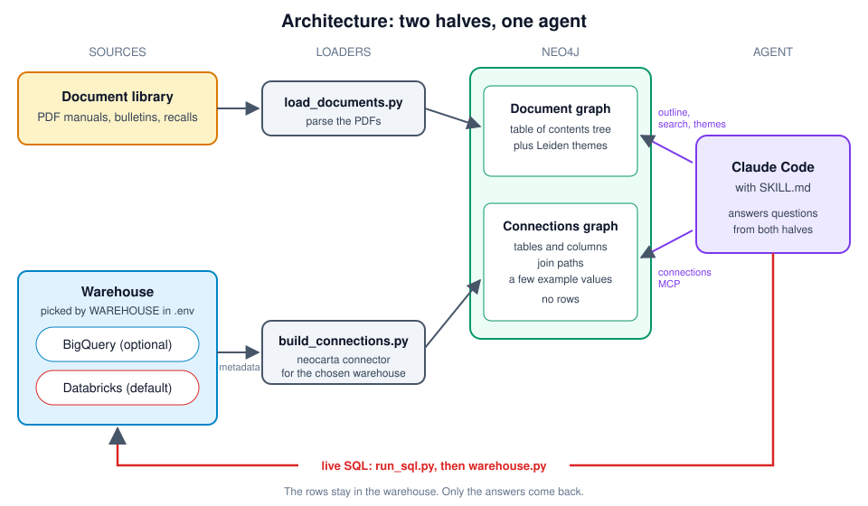
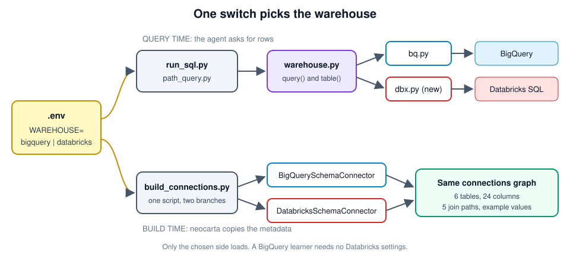
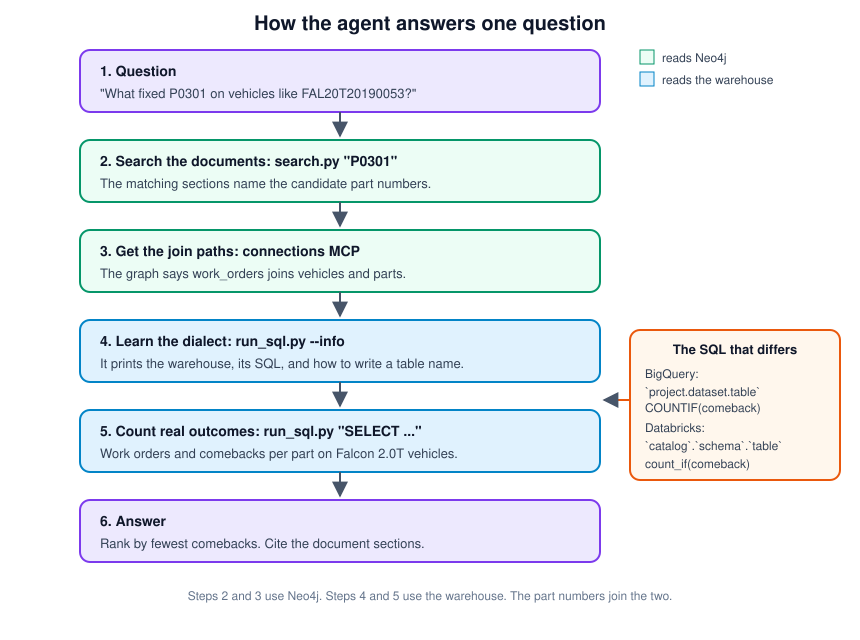

# Databricks Support: Summary

## Overview

The workshop now runs on Databricks as well as BigQuery. One setting in `.env`, `WAREHOUSE`, picks the warehouse. `WAREHOUSE=bigquery` is the default, and it works the same as before. `WAREHOUSE=databricks` sends the same scripts to a Databricks SQL warehouse.

The rows stay in the warehouse on both platforms. Neo4j holds the document graph and the warehouse metadata, plus a few example values per column. The agent writes SQL for whichever warehouse is active.

The changes are on the `dbx-lakehouse` branch. Nothing is committed yet.

## How the Code Became Generic

- **One switch:** The `WAREHOUSE` value in `.env` picks the warehouse. Every script reads this one value.
- **A shared front door:** `warehouse.py` gives every script the same two functions, `query()` and `table()`. It loads only the chosen warehouse, so a BigQuery learner needs no Databricks settings.
- **Two back ends:** `bq.py` talks to BigQuery and did not change. The new `dbx.py` talks to Databricks. Both return rows in the same shape, a list of dictionaries.
- **One connections build:** `build_connections.py` runs the neocarta connector for the chosen warehouse. Both connectors build the same graph in Neo4j.
- **One playbook:** `SKILL.md` now says "the warehouse" instead of "BigQuery". It tells the agent to run `run_sql.py --info` before its first query, so the agent learns which SQL to write.
- **Matching descriptions:** The Databricks table and schema comments now copy the BigQuery text word for word. The agent sees the same descriptions on both warehouses.
- **Docs for both:** The README, `CLAUDE.md`, and the setup scripts now name both warehouses.

## Features

- **Warehouse switch:** Set `WAREHOUSE=databricks` in `.env` to use Databricks.
- **Databricks connections graph:** `build_connections.py` reads Unity Catalog metadata into Neo4j. The test build matched BigQuery: 6 tables, 24 columns, 5 join paths, and 204 example values.
- **Dialect check:** `run_sql.py --info` prints the warehouse, its SQL dialect, and how to write a table name.
- **Databricks SQL guidance:** `SKILL.md` lists the two SQL differences that matter. Databricks quotes each part of a table name separately. It counts true values with `count_if`, because `COUNTIF` fails there.
- **Path tool on both:** `path_query.py` finds the join path in the graph, then runs the SQL on either warehouse.
- **Catch-up copies:** The scripts in `solutions/scripts/` match the skill scripts. A learner who copies from `solutions/` gets the same behavior.
- **Pinned neocarta:** `requirements.txt` installs neocarta from GitHub commit `ba6bf79`. No PyPI release has the Databricks connector yet.
- **One catalog default:** All three `databricks/` scripts default to the `lakehouse-workshop` catalog.
- **Instructor guide:** `databricks/README.md` lists the steps to load the data, set the comments, grant read access, and hand out a token.
- **Read-only access:** The learner token can read the schema and nothing else. Tests showed every write attempt fails.
- **Query tag:** Every Databricks query carries the tag `neo4j-genai-workshop-lakehouse`. Search for it in the warehouse query history.

## What Changed

- **New files:** `warehouse.py` and `dbx.py`, in both `skill/scripts/` and `solutions/scripts/`.
- **Query scripts:** Both copies of `run_sql.py` now use `warehouse.py` and have `--info`. `path_query.py` uses `warehouse.py`.
- **Connections build:** `load/build_connections.py` has a new Databricks branch. Its BigQuery branch did not change.
- **Databricks loaders:** `load_databricks.py`, `upload_pdfs.py`, and `build_doc_index.py` default to `lakehouse-workshop`. `load_databricks.py` also copies the BigQuery descriptions.
- **Setup:** `requirements.txt`, `.env.example`, `.devcontainer/post-create.sh`, and `.devcontainer/post-create-local.sh`.
- **Docs:** `README.md`, `CLAUDE.md`, `SKILL.md`, `databricks/README.md`, and one comment in `load/load_documents.py`.

## Run and Test

Run every block from the repo root in one terminal. Values in angle brackets, like `<workspace-host>`, are placeholders. The test workspace values are in `add-dbx.md`. Git ignores that file, so keep real values there and out of this one.

### Step 1: Install

```bash
cd ~/projects/workshops/genai-workshop-lakehouse
source .venv/bin/activate
pip install -r requirements.txt
python -c "from neocarta.connectors.databricks import DatabricksSchemaConnector; print('ok')"
```

Expect `ok`.

### Step 2: Check that BigQuery still works

```bash
python skill/scripts/run_sql.py --info
python skill/scripts/run_sql.py 'SELECT model, COUNT(*) AS n FROM `neo4jeventdemos.autofix_service.vehicles` GROUP BY model'
python solutions/scripts/path_query.py parts vehicles \
  --where "parts.part_number = 'IC-2042-B'" \
  --select "DISTINCT vehicles.vin, vehicles.model, work_orders.wo_id"
```

Expect these results:

- **Info:** The first command prints `warehouse: bigquery`.
- **Query:** The second prints a count per model.
- **Path:** The third prints `PATH : parts -> work_order_parts -> work_orders -> vehicles` and 20 rows. It needs a connections graph in Neo4j, from either warehouse.

### Step 3: Make sure `.env` does not override your shell

The scripts load `.env` with override on. A value in `.env` beats the same value in your shell.

```bash
grep -cE '^(WAREHOUSE|DATABRICKS_)' .env
```

Expect `0` if you plan to set the Databricks values in the shell. If the count is higher, set the values in `.env` instead, or comment those lines out.

### Step 4: Set the Databricks values

```bash
export PROFILE=<your-databricks-cli-profile>
export DATABRICKS_SERVER_HOSTNAME=<workspace-host>       # no https://
export DATABRICKS_HTTP_PATH=/sql/1.0/warehouses/<warehouse-id>
export DATABRICKS_CATALOG=lakehouse-workshop
export DATABRICKS_SCHEMA=autofix_service
export WAREHOUSE=databricks
```

### Step 5: Instructor setup, once per workspace

Create the catalog first if it does not exist. Run this in the Databricks SQL editor:

```sql
CREATE CATALOG IF NOT EXISTS `lakehouse-workshop`;
```

Load the six tables with your own short-lived login token:

```bash
DATABRICKS_TOKEN=$(databricks auth token --profile "$PROFILE" -o json | jq -r .access_token) \
  python databricks/load_databricks.py
```

If the schema existed before this load, set the comments by hand. The loader does not change comments on a schema or table that already exists. Run this in the SQL editor:

```sql
COMMENT ON SCHEMA `lakehouse-workshop`.`autofix_service` IS 'AutoFix Group service warehouse (workshop sample)';
COMMENT ON TABLE `lakehouse-workshop`.`autofix_service`.`dtc_codes` IS 'Diagnostic trouble code reference (OBD-II).';
COMMENT ON TABLE `lakehouse-workshop`.`autofix_service`.`procedures` IS 'Labor procedures performed on work orders.';
COMMENT ON TABLE `lakehouse-workshop`.`autofix_service`.`parts` IS 'Parts catalog; superseded_by points to the replacement part.';
```

Create a read-only service principal:

```bash
SP_JSON=$(databricks service-principals create --profile "$PROFILE" -o json \
  --json '{"displayName":"workshop-readonly","entitlements":[{"value":"databricks-sql-access"}]}')
export SP_APP_ID=$(echo "$SP_JSON" | jq -r .applicationId)
export SP_ID=$(echo "$SP_JSON" | jq -r .id)
echo "$SP_APP_ID $SP_ID"
```

Grant read access on the whole schema. A grant per table can drop a join path with no error. Run this in the SQL editor, with the application ID from the last step:

```sql
GRANT USE CATALOG ON CATALOG `lakehouse-workshop` TO `<sp-application-id>`;
GRANT USE SCHEMA ON SCHEMA `lakehouse-workshop`.`autofix_service` TO `<sp-application-id>`;
GRANT SELECT ON SCHEMA `lakehouse-workshop`.`autofix_service` TO `<sp-application-id>`;
```

Let the principal use the SQL warehouse and own a token. `update-permissions` adds one entry and keeps the rest:

```bash
databricks warehouses update-permissions <warehouse-id> --profile "$PROFILE" \
  --json "{\"access_control_list\":[{\"service_principal_name\":\"$SP_APP_ID\",\"permission_level\":\"CAN_USE\"}]}"
databricks token-management update-permissions --profile "$PROFILE" \
  --json "{\"access_control_list\":[{\"service_principal_name\":\"$SP_APP_ID\",\"permission_level\":\"CAN_USE\"}]}"
```

Size the SQL warehouse for the class. Concurrency is untested.

### Step 6: Make a 1-hour token for the principal

The token stays in this shell only. The `trap` line revokes it when the shell exits.

```bash
RESP=$(databricks token-management create-obo-token "$SP_APP_ID" --lifetime-seconds 3600 \
  --comment "workshop read-only test" --profile "$PROFILE" -o json)
export DATABRICKS_TOKEN=$(echo "$RESP" | jq -r .token_value)
TOKEN_ID=$(echo "$RESP" | jq -r .token_info.token_id); unset RESP
revoke() {
  unset DATABRICKS_TOKEN
  databricks token-management delete "$TOKEN_ID" --profile "$PROFILE"
  databricks token-management list --profile "$PROFILE" -o json \
    | jq -r ".[] | select(.owner_id == $SP_ID) | .token_id" | wc -l   # expect 0
}
trap revoke EXIT
```

### Step 7: Build the connections graph from Databricks

```bash
python load/build_connections.py
```

Expect `Connections graph ready: 6 tables, 5 REFERENCES (join paths).` Fewer than 5 means a grant is missing.

### Step 8: Run SQL on Databricks

```bash
python skill/scripts/run_sql.py --info
python skill/scripts/run_sql.py "SELECT count(DISTINCT w.wo_id) AS work_orders, count_if(w.comeback) AS comebacks
  FROM \`lakehouse-workshop\`.\`autofix_service\`.\`work_orders\` w
  JOIN \`lakehouse-workshop\`.\`autofix_service\`.\`vehicles\` v ON w.vin = v.vin
  WHERE v.model = 'Falcon' AND v.engine = '2.0T' AND w.dtc_code = 'P0301'"
python solutions/scripts/path_query.py parts vehicles \
  --where "parts.part_number = 'IC-2042-B'" \
  --select "DISTINCT vehicles.vin, vehicles.model, work_orders.wo_id"
```

Expect these results:

- **Info:** The first command prints `warehouse: databricks` and the table form `` `lakehouse-workshop`.`autofix_service`.`<table>` ``.
- **Counts:** The second prints 29 work orders and 6 comebacks. BigQuery gives the same numbers.
- **Path:** The third prints the same path as on BigQuery and 20 rows.

### Step 9: Test the agent on the warehouse

Do not tell the agent which warehouse it is on. The test checks that `SKILL.md` and `--info` lead it to the right SQL.

Headless `claude -p` needs the `--model` flag when Claude Code runs through the Databricks gateway. Without it, the gateway rejects the default model name with a 403.

```bash
claude mcp list   # expect: connections ... Connected
MODEL="$ANTHROPIC_DEFAULT_SONNET_MODEL"
ALLOWED='Skill,Read,mcp__connections__*,Bash(python skill/scripts/run_sql.py:*),Bash(python skill/scripts/search.py:*),Bash(python skill/scripts/outline.py:*)'
Q1='Using the autofix-service-advisor skill: on Falcon vehicles with the 2.0T engine, how many work orders were diagnosed with P0301, and how many of those were comebacks?'
claude -p "$Q1" --model "$MODEL" --allowedTools "$ALLOWED" \
  --output-format stream-json --verbose --max-turns 30 < /dev/null > /tmp/agent_q1.jsonl
```

Show what the agent ran and what it answered:

```bash
jq -r 'select(.type=="assistant") | .message.content[]? | select(.type=="tool_use") | .name + "  " + ((.input.command // (.input|tostring)) | .[0:300])' /tmp/agent_q1.jsonl
jq -r 'select(.type=="result") | .result' /tmp/agent_q1.jsonl
grep -c dapi /tmp/agent_q1.jsonl   # expect 0: no token in the transcript
```

The test passes when all of these are true:

- **Info first:** The agent ran `run_sql.py --info` before its first SQL.
- **Table form:** Each part of every table name has its own backticks.
- **Counting:** The agent used `count_if(comeback)` and never ran a failed `COUNTIF`.
- **Joins:** The agent took its joins from the `connections` MCP.
- **Numbers:** The answer is 29 work orders and 6 comebacks.

For the second warehouse question and its expected numbers, see Test A in the RYAN TODO section of `add-dbx.md`.

### Step 10: Load the documents and ask the full question

This step writes the document graph to the Neo4j instance in `.env`. The connections graph stays.

```bash
python load/load_documents.py
python skill/scripts/search.py "P0301"   # expect hits with section URIs
ALLOWED_B="$ALLOWED,Bash(python skill/scripts/themes.py:*),Bash(neo4j-cli:*)"
Q3='Using the autofix-service-advisor skill: what fixed P0301 on vehicles like FAL20T20190053?'
claude -p "$Q3" --model "$MODEL" --allowedTools "$ALLOWED_B" \
  --output-format stream-json --verbose --max-turns 40 < /dev/null > /tmp/agent_q3.jsonl
jq -r 'select(.type=="result") | .result' /tmp/agent_q3.jsonl
grep -c dapi /tmp/agent_q3.jsonl   # expect 0
```

The answer passes when all of these are true:

- **Grounding:** It cites document section URIs found by search.
- **Vehicle:** It reads FAL20T20190053 as a Falcon 2.0T from the warehouse.
- **Ranking:** It ranks IC-2042-B first, with 18 uses and 0 comebacks.

### Step 11: Clean up

```bash
exit   # the trap revokes the token; the last line it prints should be 0
```

To go back to BigQuery, open a new terminal. `WAREHOUSE` falls back to `bigquery` when the shell and `.env` do not set it.

## Architecture

### The Big Picture



- **Documents:** `load_documents.py` parses the PDFs into a document graph in Neo4j.
- **Warehouse metadata:** `build_connections.py` copies the table and column metadata into a connections graph. It also copies a few example values per column. It never copies the rows.
- **Agent:** Claude Code reads both graphs, then runs live SQL on the warehouse for the facts.

### The Warehouse Switch



- **Query time:** `run_sql.py` and `path_query.py` call `warehouse.py`. It hands the SQL to `bq.py` or `dbx.py`, based on `WAREHOUSE`.
- **Build time:** `build_connections.py` picks the matching neocarta connector. Both connectors produce the same graph, so the agent's tools work the same on both.

### One Question, Start to Finish



- **Neo4j steps:** The agent searches the documents for the trouble code. The matching sections name the parts. The connections graph gives the join paths.
- **Warehouse steps:** `--info` tells the agent which SQL to write. The SQL counts how often each part was used and how often the vehicle came back.
- **The link:** Part numbers appear in both the documents and the warehouse. That shared key joins the two halves.

## Known Limits and Open Items

- **BigQuery build check:** The BigQuery connections build has not run at the new neocarta pin. This blocks the merge.
- **Host and path:** `.env.example` gets the Databricks host and HTTP path once the live workspace is chosen. The test workspace values stay out of the repo.
- **Agent tests:** Steps 9 and 10 have not passed yet. Step 9 decides whether the course can merge its two warehouse tabs into one note.
- **Load test:** Nobody has tested many learners on one SQL warehouse. Size the warehouse for the class.
- **Shared Neo4j:** `path_query.py` reads join paths from every database in Neo4j. Build only one warehouse into each Neo4j instance.
- **GCP_PROJECT_ID:** `build_connections.py` still needs it set on Databricks, because it reads it on start. `.env.example` sets it.
- **Code review:** zooz's review found no high-severity issues. Seven findings are fixed. The host and path wording waits on the live workspace, and the install time check waits for Phase 6. See the zooz code review table in `add-dbx.md`.
